# Step 00 — Overview: what Kubernetes is, what we'll build, and your tools

> **Goal of this step:** understand _why_ Kubernetes exists, see the complete system you will build
> by the end, understand its two most important architectural ideas (**API gateways** and
> **authentication**), get to know the tools on your machine, and confirm your machine is ready.
> No Kubernetes yet. We set up the starting point here.

---

## 1. Where we are

Nowhere yet, which is the right place to start. This repository has a few files that organise the
tutorial, plus one script that checks your machine:

```text
kubernetes-tutorial/
├── AGENTS.md            ← rules for the AI agent that guides you (CLAUDE.md points here)
├── CLAUDE.md -> AGENTS.md
├── TUTORIAL-INDEX.md    ← progress tracker: what's done, what's next
├── README.md
├── docs/
│   └── 00-overview.md   ← you are here
└── scripts/
    └── check-prereqs.sh ← checks that your machine is ready
```

Every step adds things to this tree. At the end it will contain seven applications, a Kubernetes
cluster configuration, and over a hundred manifests.

---

## 2. What you'll learn

- What problem Kubernetes solves, explained without jargon.
- What a **container** is, in one paragraph (Step 01 goes into much more depth).
- What **Kubernetes** is: a system that keeps the **actual state** of your software equal to the
  **desired state** you describe.
- The full **Bookstore** system we'll build, and how a request travels through it.
- What a **reverse proxy** and an **API gateway** are; the difference between a gateway you
  **configure** (Kubernetes Gateway API + Envoy Gateway) and one you **write** (YARP); and why we use
  **both, stacked**.
- What **authentication** is, why we don't build our own login system, what **Keycloak** does,
  and where our **custom authentication logic** lives.
- What each tool on your machine does: **Docker**, **kind**, **kubectl**, **Helm**, **git**.
- One quirk of your setup (WSL2 + Docker Desktop) that affects networking.
- How every step of this tutorial is organised.

---

## 3. Concepts

### 3.1 The problem: running software is harder than writing it

Say you wrote a small web application. On your laptop you start it with a single command, and it
listens for requests. Now other people need to use it. A list of questions shows up:

| Question                                                                  | Without help, you…                                                                            |
| ------------------------------------------------------------------------- | --------------------------------------------------------------------------------------------- |
| **Where** does it run?                                                    | Rent a server, log in, install the right language version and libraries, copy the code.       |
| It **crashed** at 3 a.m. Who restarts it?                                 | You do, when you wake up.                                                                     |
| The **server** died.                                                      | You set up a new server from scratch.                                                         |
| Lots of users arrived. How do you run **more copies**?                    | Buy more servers, install everything again, and put something in front to spread the traffic. |
| You have a **new version**. How do you update without downtime?           | Stop, copy, start, and hope nothing breaks.                                                   |
| The app needs a **database password**. Where does it live?                | In a file on the server, ideally not in the code.                                             |
| You have 5 apps that **talk to each other**. How do they find each other? | You hard-code IP addresses, which break whenever something moves.                             |
| "**It works on my machine**" but not on the server.                       | Different library versions. Good luck.                                                        |

Every one of these problems is solvable by hand. But "by hand" doesn't scale: a company with
200 services on 50 machines can't have a person babysitting each one.

### 3.2 Step one of the solution: containers (preview)

A **container** packages an application **together with everything it needs to run**: the right
language runtime, libraries, config files, and even a minimal Linux userland. The package is called
an **image**. Run the image and you get a **container**, which is a normal process on the machine,
**isolated** from other processes. It sees its own filesystem, its own network, and its own process
list.

Analogy: a shipping container. A ship doesn't care whether a container holds bananas or laptops,
because all containers have the same shape. In the same way, a machine that can run containers can
run _any_ containerised app, in any language, with no installation.

This fixes "it works on my machine": the machine is now _inside_ the package.

> Step 01 opens the box: what an image really is (layers of files), and how Linux isolates a
> container (namespaces and cgroups). For now, hold on to **image = package** and
> **container = a running, isolated instance of that package**.

### 3.3 Step two of the solution: an orchestrator — Kubernetes

Containers solve **packaging**. They don't solve the rest of the table: restarts, many machines,
scaling, updates, configuration, and services finding each other. That's the job of an
**orchestrator**, and **Kubernetes** (often written **K8s**: K, then 8 letters, then s) is the
most widely used one.

**Analogy first.** Think of Kubernetes as a very diligent **operations team that never sleeps**.
You don't tell it _how_ to do things step by step. You hand it a **written description of what you
want**:

> "I want 3 copies of the catalog API, version 1.4, each with 0.5 CPU and 256 MB of memory,
> reachable by other apps under the name `catalog-api`, and with the database password from the
> secret called `db-credentials`."

The team then works **continuously** to make reality match that description:

- A copy crashes → they start a new one.
- A machine dies → they move its copies to the machines that are still healthy.
- You change "3 copies" to "10" → they start 7 more.
- You change "version 1.4" to "1.5" → they replace the copies gradually, so the service never goes
  down.

**Now the precise version.** Kubernetes is a **declarative** system built on a **reconciliation
loop**:

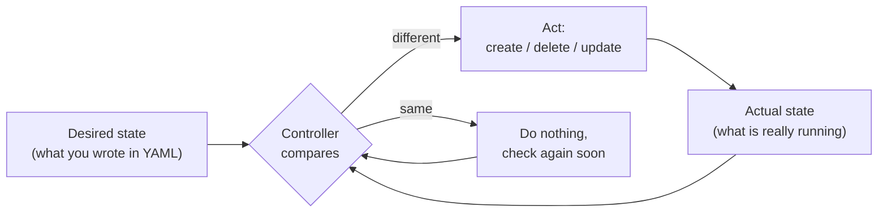

1. You store the **desired state** in Kubernetes as small documents called **objects**, usually
   written as **YAML files** called **manifests**.
2. Many small programs called **controllers** each watch one kind of object. They compare desired
   state with actual state, and when the two differ, they act to close the gap.
3. They never stop. That's why Kubernetes **heals itself**: it isn't reacting to a single event, it
   keeps re-checking the gap.

That contrasts with the **imperative** style ("run this, then that"):

| Imperative ("how")                                | Declarative ("what")                          |
| ------------------------------------------------- | --------------------------------------------- |
| `start container A` ×3                            | `replicas: 3`                                 |
| If one dies, someone has to notice and restart it | The controller sees 2 ≠ 3 and starts one more |
| A script describes _actions_                      | A manifest describes the _result_             |

> 🔑 **Key idea of the whole tutorial:** in Kubernetes you **describe the result you want**, and
> controllers **continuously make it true**. Almost every feature you'll meet is a new kind of
> object plus a controller that makes it true. (You'll see this again in §3.7.5: the Kubernetes API
> gateway works exactly this way.)

### 3.4 What Kubernetes is _not_

Knowing what something doesn't do clears up a lot of confusion:

- **Not a container runtime.** It doesn't run containers itself. It asks a runtime (containerd) on
  each machine to do it.
- **Not a build tool.** It doesn't turn your code into images. You (or a CI pipeline) build the
  images first, then Kubernetes runs them.
- **Not one program.** It's a set of cooperating components (Step 03 takes them apart).
- **Not magic networking.** Every "it just reaches the other service" relies on ordinary Linux
  networking: IP addresses, routing tables, NAT rules, DNS. Steps 02, 06 and 07 show you each
  piece.
- **Not a complete platform out of the box.** For many jobs (networking, storage, the API gateway)
  Kubernetes defines a **standard interface** and expects you to install an **implementation**. More
  on this in §3.7.5.
- **Not always necessary.** For one small app, a single server is fine. Kubernetes pays off when you
  have many services, many machines, or strict uptime needs. We'll learn it on a small system
  because the concepts are the same at any size.

### 3.5 The system you will build: **Bookstore**

A small online bookshop. You can browse books without logging in. To buy, you log in, and an admin
can add books. It's small enough to understand completely, and realistic enough to need every
important Kubernetes feature.

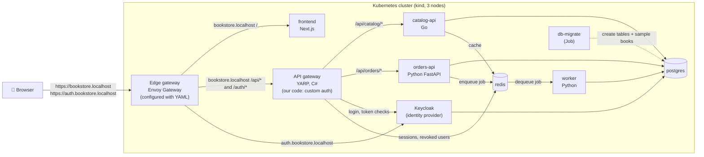

| Component                                | What it does                                                                                                                                                          | Why it's in the tutorial                                                                       |
| ---------------------------------------- | --------------------------------------------------------------------------------------------------------------------------------------------------------------------- | ---------------------------------------------------------------------------------------------- |
| **Edge gateway** (Envoy Gateway)         | The cluster's front door. Handles HTTPS, picks the right destination by **hostname** and **path**, blocks floods of requests. Configured purely with Kubernetes YAML. | How traffic gets **into** a cluster; the Kubernetes **Gateway API**.                           |
| **API gateway** (`api-gateway`, YARP/C#) | Our own gateway, written in code. Handles login and logout, checks who you are on every API call, enforces "who may call what", and tells the APIs who the user is.   | How a **code-based gateway** works; **custom authentication**; sharing sessions across copies. |
| **Keycloak**                             | The **identity provider**: stores users and passwords, shows the login page, issues tokens.                                                                           | Running a real third-party application on Kubernetes.                                          |
| **frontend**                             | The website you see. Built with Next.js (a React framework).                                                                                                          | A typical web app: stateless, easy to scale.                                                   |
| **catalog-api**                          | Returns books and book details (public), and lets admins add books. Reads Postgres, caches in Redis.                                                                  | Configuration, secrets, health checks, autoscaling.                                            |
| **orders-api**                           | Accepts orders from logged-in users, saves them, and queues a "process this order" job.                                                                               | How services find and talk to each other; trusting identity headers.                           |
| **worker**                               | Takes jobs off the queue and "processes" orders (pending → paid → shipped).                                                                                           | Background work with no web traffic, and graceful shutdown.                                    |
| **postgres**                             | The database: books, orders, and Keycloak's own data.                                                                                                                 | Data that must survive restarts: persistent storage and StatefulSets.                          |
| **redis**                                | In-memory store: cache, job queue, login sessions, revoked-user list.                                                                                                 | A shared store that lets many copies of a service behave as one.                               |
| **db-migrate**                           | Runs once to create database tables and insert sample books.                                                                                                          | Jobs: containers meant to finish rather than run forever.                                      |
| **loadgen**                              | A small tool that floods the system with requests.                                                                                                                    | Lets us watch autoscaling happen.                                                              |

Why several languages (Go, Python, C#, TypeScript)? Kubernetes doesn't care what's inside a
container. They all run side by side, and that's the point.

Sections §3.7 and §3.8 explain the two gateways and the authentication design in depth, because
they're the parts of the architecture people most often get wrong.

### 3.6 The journey of one request (preview)

What happens when a **logged-in** user clicks **"Buy"**:

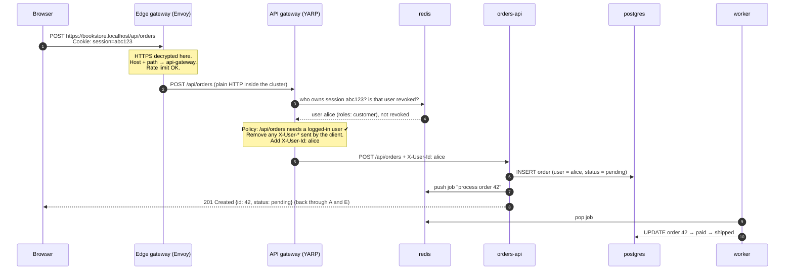

The diagram looks simple, but each arrow hides several questions you'll learn to answer:

- How does `orders-api` know the IP address of `postgres`? → **DNS and Services** (Step 07)
- How does a packet get from a container on machine A to a container on machine B? → **pod
  networking and CNI** (Steps 02 and 06)
- What if there are 3 copies of `orders-api`: which one gets the request? → **Services and
  kube-proxy load balancing** (Step 07)
- Where does the database password come from? → **Secrets** (Step 08)
- What if postgres restarts: are the orders lost? → **PersistentVolumes** (Step 09)
- How does HTTPS traffic from your browser get into the cluster? → **Gateway API** (Step 11)
- How did the user log in, and how does the gateway know who they are? → **Keycloak, OIDC, sessions**
  (Step 12)
- What stops someone inside the cluster from calling `orders-api` directly with a fake
  `X-User-Id`? → **NetworkPolicies** (Step 15)

### 3.7 The front door: reverse proxies and API gateways

This is one of the most misunderstood parts of any architecture, so we'll build it up from zero.

#### 3.7.1 The problem: many services, one address

Bookstore has a frontend and several APIs, each its own program with its own address inside the
cluster. Your browser shouldn't have to know any of that. It should talk to **one** address
(`https://bookstore.localhost`) and never see the internals.

There's a second problem too. Some jobs are needed by **every** service:

- speaking HTTPS (encryption and certificates),
- checking who the user is,
- refusing abusive traffic (too many requests),
- logging every request.

Writing all of that again inside every service (in Go, Python, …) would be repetitive and error
prone. It's better to do it **once**, at the door.

Both problems have the same solution: **put one program in front of everything**.

#### 3.7.2 What a reverse proxy is

A **proxy** is a program that makes requests **on behalf of someone else**. There are two
directions:

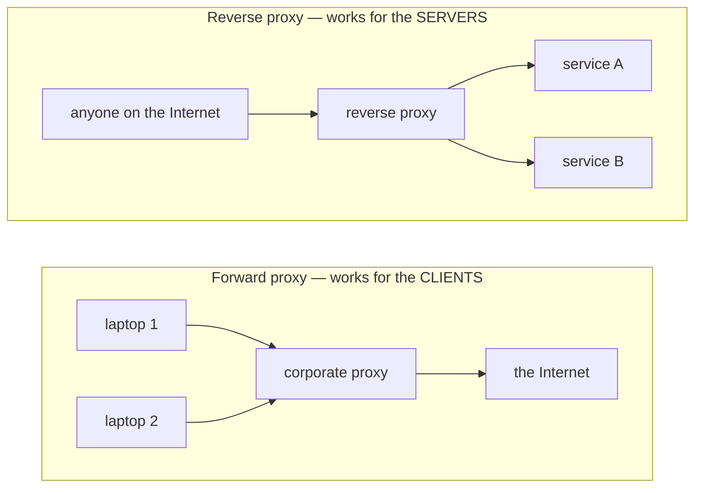

- A **forward proxy** sits in front of _clients_. A company's proxy that all employee laptops use
  to reach the Internet is one.
- A **reverse proxy** sits in front of _servers_. Clients think they're talking to "the
  website", but they're actually talking to the proxy, which forwards each request to the right
  server behind it.

What a reverse proxy does with every request:

```text
browser ──► [ reverse proxy ] ──► catalog-api
                │  1. read the request: method, host, path, headers
                │       GET /api/catalog/books   Host: bookstore.localhost
                │  2. decide where it goes:  path starts with /api/catalog → catalog-api
                │  3. (optional) check it:   is this user logged in? too many requests?
                │  4. (optional) change it:  add/remove headers, rewrite the path
                │  5. forward it, wait for the answer
                └─ 6. send the answer back to the browser
```

The browser **never connects directly** to `catalog-api`. It doesn't even know it exists.

> HTTP itself (methods, headers, cookies) and HTTPS are covered from zero in Step 02. For now, an
> HTTP request is a small text message: a **method** (`GET`, `POST`), a **path** (`/api/orders`),
> some **headers** (`Host:`, `Cookie:`), and sometimes a **body**.

#### 3.7.3 From reverse proxy to API gateway

An **API gateway** is a reverse proxy **specialised for APIs**: a reverse proxy plus a set of
features most APIs need.

| Feature                 | What it means                                                          |
| ----------------------- | ---------------------------------------------------------------------- |
| **Routing**             | `/api/catalog/*` → catalog-api, `/api/orders/*` → orders-api           |
| **TLS termination**     | Decrypts HTTPS at the door; traffic behind it can be plain HTTP        |
| **Authentication**      | "Who are you?": check a session or token before letting the request in |
| **Authorization**       | "Are you allowed to do this?": only admins may add books               |
| **Rate limiting**       | At most N requests per second per client                               |
| **Header manipulation** | Add `X-User-Id`, remove headers the client must not set                |
| **CORS**                | Browser rules about which websites may call your API                   |
| **Timeouts / retries**  | Don't wait forever; retry a failed call safely                         |
| **Observability**       | One place to log and measure every request                             |

So "API gateway" isn't a specific product. It's a **role**, and there are different ways to fill it.

#### 3.7.4 Two ways to get one: configure a finished program, or write your own

Think of the **reception desk of an office building**.

- **Option 1: hire a receptionist from an agency.** They're already trained. You give them
  **written instructions on a standard form**: "visitors for floor 3 go to Accounting; check every
  badge is valid; at most 10 visitors per minute". They follow the form perfectly. But they can only
  do things **the form has a field for**.
- **Option 2: build your own receptionist.** They can do anything you program: "phone HR to check
  this person isn't suspended, look up their department, stamp their badge with their role". But
  you build, test, fix and maintain them yourself, and if they break, nobody gets in.

Those are the two kinds of API gateway. Here's the **same routing rule** written both ways.

**Option 1: a finished program (Envoy) configured with Kubernetes YAML.** You write no program,
only a description:

```yaml
# "Requests whose path starts with /api/catalog go to the catalog-api Service"
apiVersion: gateway.networking.k8s.io/v1
kind: HTTPRoute
metadata:
  name: catalog
spec:
  parentRefs: [{ name: bookstore-gateway }]
  rules:
    - matches: [{ path: { type: PathPrefix, value: /api/catalog } }]
      backendRefs: [{ name: catalog-api, port: 80 }]
```

**Option 2: your own program (YARP) written in C#.** YARP is a library that does the forwarding;
you write the application around it and add any logic you like:

```csharp
// Routes come from configuration: /api/catalog/{**rest} → http://catalog-api
var app = builder.Build();

app.Use(async (ctx, next) =>
{
    var user = await MyCustomAuth(ctx.Request);   // YOUR code: Redis, a database, anything
    if (user is null) { ctx.Response.StatusCode = 401; return; }
    ctx.Request.Headers["X-User-Id"] = user.Id;   // tell the API who the user is
    await next();                                 // let YARP forward the request
});

app.MapReverseProxy();                            // YARP: forward to the matching service
app.Run();
```

The question that separates them is **where the gateway logic lives**:

- **Option 1:** in **configuration** of a program someone else wrote. You can only express what
  that configuration language supports.
- **Option 2:** in **code** you wrote. You can express anything, and you're responsible for all
  of it.

#### 3.7.5 Option 1 in depth: the Kubernetes Gateway API and Envoy Gateway

**Does Kubernetes have its own API gateway?** Half yes. Kubernetes defines **the standard way to
describe** a gateway (the **Gateway API**), but it **doesn't include the program that does the
work**. You install one of many implementations.

This "standard interface + pluggable implementation" pattern shows up all over Kubernetes:

| Kubernetes defines…                              | …and you choose an implementation                                        |
| ------------------------------------------------ | ------------------------------------------------------------------------ |
| How containers are run (CRI)                     | containerd, CRI-O                                                        |
| How pods get a network (CNI)                     | kindnet, Calico, Cilium (Step 06)                                        |
| How storage is attached (CSI)                    | local-path, AWS EBS, Azure Disk (Step 09)                                |
| **How traffic enters the cluster (Gateway API)** | **Envoy Gateway**, NGINX Gateway Fabric, Istio, Cilium, Kong, Traefik, … |

The Gateway API is a set of object types. The three main ones match three different jobs
(roles) in a real company:

| Object         | Who writes it                       | What it says                                                                                 |
| -------------- | ----------------------------------- | -------------------------------------------------------------------------------------------- |
| `GatewayClass` | Whoever installs the implementation | "Gateways of this class are handled by Envoy Gateway"                                        |
| `Gateway`      | The platform / cluster team         | "Open a front door that listens for HTTPS on `*.bookstore.localhost`, with this certificate" |
| `HTTPRoute`    | Each application team               | "On that door, path `/api/catalog` goes to my service"                                       |

Remember §3.3: an object on its own does nothing. Kubernetes **stores** your `HTTPRoute` and that's
it. Something has to read it and act. That something is a **controller**:

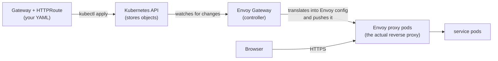

Two names that are easy to mix up:

- **Envoy** is the **reverse proxy program** itself: a fast proxy written in C++, used by many large
  companies. It's the thing your requests actually pass through.
- **Envoy Gateway** is the **controller**. It reads Gateway API objects and turns them into Envoy
  configuration. Requests never pass through it.

Why this approach is valuable:

- **Kubernetes-native:** the gateway is configured like everything else: YAML, `kubectl`, git.
- **Portable:** swap Envoy Gateway for NGINX Gateway Fabric or Istio, and your `HTTPRoute`s keep
  working unchanged. That's the whole point of a standard.
- **Shared safely:** each team writes its own `HTTPRoute`s without touching the `Gateway`.
- **No code to maintain.** Thousands of people already debugged it.

The limit: you can only do what the Gateway API plus the implementation's extensions support.
Envoy Gateway is quite capable. It handles routing, TLS, rate limiting, CORS, JWT checking, and even
standard OpenID Connect logins. But as soon as you need **logic that's specific to your business**
("check our revoked-user list in Redis, then decide based on the route and the user's role"), YAML
can't express it. Envoy can only **call out to an external service that you write** to make the
decision. Either way, custom logic means **your own code** somewhere.

> You'll also meet **Ingress**, the older and simpler predecessor of the Gateway API. It's still
> everywhere, so Step 11 compares the two.

#### 3.7.6 Option 2 in depth: code-based gateways (YARP)

**YARP** ("Yet Another Reverse Proxy") is a **.NET library** from Microsoft. It does the hard,
low-level part of being a reverse proxy: efficient forwarding, connection pooling, load balancing,
health checks. Around it you write a normal **ASP.NET Core** application. Similar tools exist in
other languages: Spring Cloud Gateway (Java), Ocelot (.NET), or a few lines of Go with
`httputil.ReverseProxy`.

Two common misunderstandings:

1. **It isn't "external" to Kubernetes.** You build it into an image and deploy it like any other
   app (a Deployment and a Service, Steps 05 and 07). It's **just more pods inside the cluster**.
2. **On its own it isn't the cluster's front door.** It still needs a way to receive traffic from
   outside: either something in front of it (a Gateway API implementation), or exposing it yourself
   with a `NodePort`/`LoadBalancer` Service (Step 07).

What you get: **unlimited flexibility**. Custom authentication, calling other services before
deciding, combining several API calls into one response, business-specific rules. What it costs:
**you own it**. Its bugs, its security holes, its performance and its scaling are your problem,
and it's in the path of _every_ request.

#### 3.7.7 Option 3, briefly: managed API gateways outside the cluster

Cloud services such as **Azure API Management**, **AWS API Gateway** or **Kong Konnect** run
**outside** your cluster, operated by the provider, in front of the cluster's load balancer. Companies
use them when they **publish APIs to other companies**: developer portals, API keys, usage plans,
billing. We won't use one, but you should know where they fit.

#### 3.7.8 Do we need both? Are they different?

They're **the same kind of thing** (reverse proxies doing API-gateway jobs), built in **different
ways** (configured vs coded). And **no, you don't need both**. Each works alone:

| Setup              | How traffic gets in                                     | Good when                                                |
| ------------------ | ------------------------------------------------------- | -------------------------------------------------------- |
| Envoy Gateway only | Envoy is the front door and routes straight to services | Standard routing and standard authentication are enough  |
| YARP only          | You expose the YARP pods to the outside yourself        | Small systems that need custom logic and nothing else    |
| **Both, stacked**  | Envoy is the front door and passes API traffic to YARP  | Real companies with many teams, domains and custom rules |

Real companies often stack them because the two layers have **different owners and different
jobs**:

|                 | Edge gateway (Envoy Gateway)                 | Application gateway (YARP)             |
| --------------- | -------------------------------------------- | -------------------------------------- |
| Owned by        | Platform / infrastructure team               | Application team                       |
| Changes         | Rarely (new domain, new certificate)         | Often (new routes, new auth rules)     |
| Knows about     | Hostnames, certificates, IPs, raw traffic    | Users, roles, sessions, business rules |
| Configured with | Kubernetes YAML                              | Code + configuration                   |
| Serves          | The whole cluster (it could serve many apps) | One application (Bookstore)            |

This is also why a code-based gateway focused on one frontend is often called a **BFF**
("**B**ackend **F**or **F**rontend"): a gateway tailored to what one particular frontend needs.

#### 3.7.9 How Bookstore splits the work between the two gateways

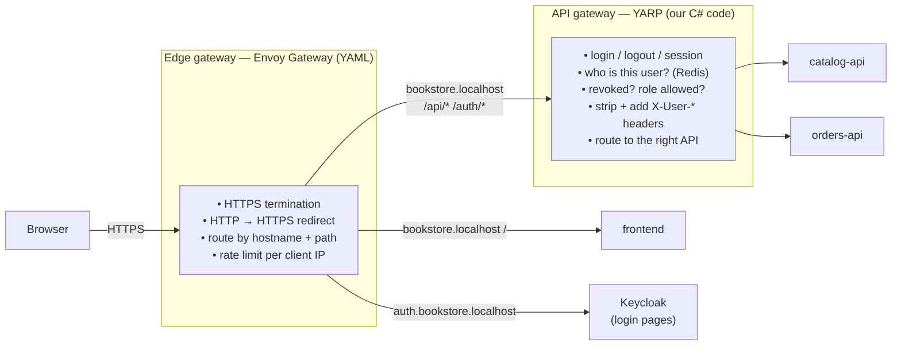

| Concern                                              | Edge (Envoy) | API gateway (YARP) | Why there                                    |
| ---------------------------------------------------- | ------------ | ------------------ | -------------------------------------------- |
| HTTPS certificates                                   | ✅           |                    | Infrastructure; one place for every hostname |
| Hostname routing (`bookstore.` vs `auth.bookstore.`) | ✅           |                    | It's the cluster's single entry point        |
| Coarse rate limiting per IP                          | ✅           |                    | Stop floods before they cost us anything     |
| `/` → frontend                                       | ✅           |                    | Pages don't need our auth logic              |
| Login, logout, session handling                      |              | ✅                 | Custom: tokens stay on the server (§3.8.5)   |
| "Who is this user, are they revoked?"                |              | ✅                 | Custom business logic with Redis             |
| "May this user call this route?"                     |              | ✅                 | Business rules (admin-only, login-only)      |
| Adding `X-User-Id` / `X-User-Roles`                  |              | ✅                 | Downstream APIs stay simple                  |
| `/api/catalog` vs `/api/orders` routing              |              | ✅                 | The app team owns its API layout             |

#### 3.7.10 The trust chain: why identity headers need network rules

The APIs (`catalog-api`, `orders-api`) **contain no login code at all**. They read the `X-User-Id`
header and trust it. That keeps them simple, but it raises an obvious question: _what if someone
sends a fake `X-User-Id` themselves?_

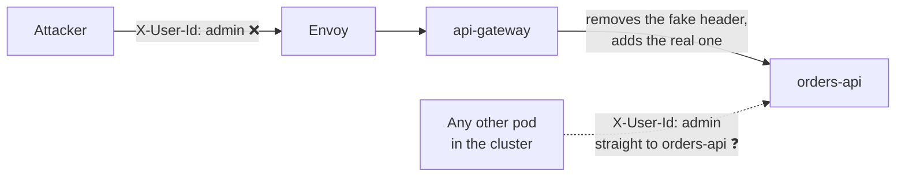

1. **From outside:** the API gateway **always removes** any `X-User-*` headers the client sent, then
   adds the real ones. Faking them from a browser doesn't work.
2. **From inside the cluster:** by default **every pod can reach every other pod**, so a
   compromised pod could skip the gateway entirely. The fix is a **NetworkPolicy**: "only
   `api-gateway` may talk to `orders-api`". You'll do the attack and then block it in Step 15.

This is a real-world lesson: **an architecture is only as secure as the network rules that
enforce it.**

### 3.8 Who are you? Authentication, Keycloak, and our custom logic

#### 3.8.1 Authentication vs authorization

Two words that are always confused:

|                            | Question                      | Example in Bookstore                                 | Failure response                                       |
| -------------------------- | ----------------------------- | ---------------------------------------------------- | ------------------------------------------------------ |
| **Authentication** (AuthN) | _Who are you?_                | "This request comes from alice."                     | `401 Unauthorized` (it really means "unauthenticated") |
| **Authorization** (AuthZ)  | _Are you allowed to do this?_ | "alice may place orders; only admins may add books." | `403 Forbidden`                                        |

#### 3.8.2 Why we don't write our own login system

A login form looks easy. A _safe_ login system isn't. You'd need: storing passwords securely
(slow, salted hashing), password reset by email, brute-force protection, account lockout,
two-factor authentication, session expiry, "log out everywhere", and keeping up with security
fixes forever. Every one of these is a common source of security breaches.

So the industry standard is: **use a dedicated identity provider, and never touch passwords in
your own services.**

#### 3.8.3 Identity provider, and Keycloak

An **identity provider** (IdP) is a service whose only job is managing users and proving who they
are. Analogy: the **passport office**. It checks your identity once and issues you a document
(a **token**) that others can verify without calling the office every time. Our API gateway is the
**border control** that checks those documents.

**Keycloak** is a popular **open-source** identity provider (a Java application). Its main
concepts:

| Keycloak concept | Meaning                                                       | In Bookstore                                 |
| ---------------- | ------------------------------------------------------------- | -------------------------------------------- |
| **Realm**        | An isolated "world" of users and settings                     | `bookstore`                                  |
| **User**         | A person who can log in                                       | `alice`, `bob` (customers), `admin`          |
| **Role**         | A label that grants permissions                               | `customer`, `admin`                          |
| **Client**       | An application that's allowed to ask Keycloak to log users in | `api-gateway` (and a CLI client for scripts) |

Managed alternatives (Auth0, Microsoft Entra ID, AWS Cognito, Okta) work the same way, because they
all speak the same standard protocols: **OAuth 2.0** and **OpenID Connect (OIDC)**. What you learn
with Keycloak carries over directly to them.

#### 3.8.4 Tokens in one minute: JWT

After a successful login, Keycloak issues **tokens**. The main format is **JWT** (JSON Web Token,
pronounced "jot"): three base64-encoded parts separated by dots:

```text
eyJhbGciOiJSUzI1NiJ9 . eyJzdWIiOiJhbGljZSIsInJvbGVzIjpbImN1c3RvbWVyIl0sImV4cCI6MTc2MzAwMDAwMH0 . Qm9n…
      header                         payload ("claims")                                         signature
 {"alg":"RS256"}        {"sub":"alice","roles":["customer"],"exp":1763000000}       made with Keycloak's PRIVATE key
```

- The **payload** says who the user is, their roles, and when the token expires.
- The **signature** proves Keycloak issued it and nobody changed it. Anyone can **verify** it with
  Keycloak's **public** key (published at a well-known URL, the **JWKS**) without calling Keycloak
  for every request. That's fast.
- A JWT is **signed, not encrypted**: anyone holding it can read it. Never put secrets in it.
- **Weakness:** a JWT stays valid until it expires. If you ban a user, their token still works
  until then. Our custom logic fixes this (§3.8.6).

#### 3.8.5 Where should the tokens live? The BFF pattern

The tempting design is to let the browser's JavaScript log in and keep the token. But any
malicious script that gets onto the page (an **XSS** attack) can steal it. Current security
guidance for browser apps is the **BFF pattern**: **the tokens never reach the browser.**

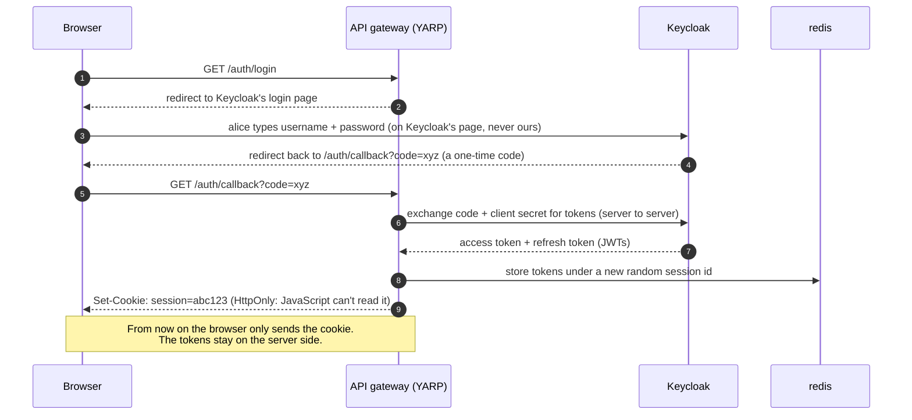

This is the "**Authorization Code**" flow of OpenID Connect. Step 12 walks through every message
in detail.

#### 3.8.6 Our custom authentication logic, step by step

This is the code you'll read in `apps/api-gateway` (Step 01) and deploy in Step 12. For **every**
request to `/api/*`:

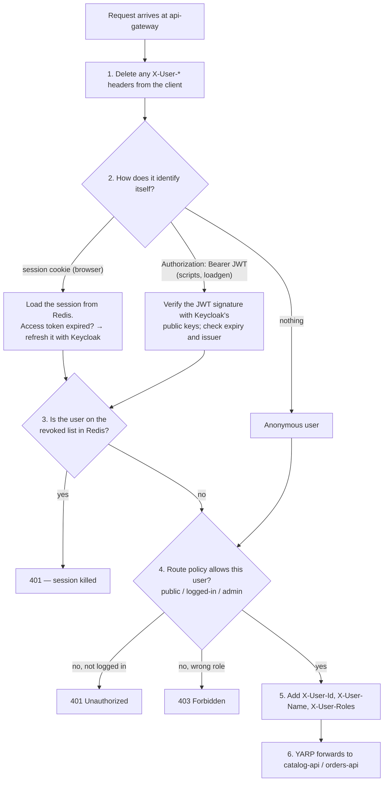

Route policies in Bookstore:

| Route                           | Who may call it                                           |
| ------------------------------- | --------------------------------------------------------- |
| `GET /api/catalog/*`            | Anyone (public)                                           |
| `POST /api/catalog/books`       | Role `admin`                                              |
| `/api/orders/*`                 | Any logged-in user (each user sees only their own orders) |
| `POST /api/admin/revoke/{user}` | Role `admin`: instantly kills all of that user's sessions |

Step 3 (the revoked list) is the part standard tools can't do from YAML alone, and the reason a
custom gateway exists.

#### 3.8.7 Why Keycloak + custom logic in the gateway (and not a custom auth-api)

| Option                                                         | Verdict                                                                                                                                                                                                  |
| -------------------------------------------------------------- | -------------------------------------------------------------------------------------------------------------------------------------------------------------------------------------------------------- |
| **Custom `auth-api` only** (our own users table and passwords) | ❌ Reinvents the most dangerous wheel (§3.8.2). Teaches bad habits.                                                                                                                                      |
| **Keycloak + a separate custom `auth-api`**                    | ❌ Two places own identity. Anything the `auth-api` would do (sessions, extra checks) belongs in the request path, which is the gateway. An extra service with no clear job is complexity without value. |
| **Keycloak + custom logic inside the API gateway** ✅          | Keycloak does what it's good at (users, passwords, login pages, tokens). Our gateway does what's specific to us (sessions, revocation, policies, headers). Each part has one clear job.                  |

#### 3.8.8 What this means for Kubernetes

This design isn't only an auth lesson. It creates some of the most instructive Kubernetes problems
in the tutorial:

- **Keycloak** is a heavyweight third-party Java app (~1 GB of memory), with a slow start and its
  data in Postgres. It's ideal for learning **resource limits, startup and readiness probes**
  (Step 10) and **importing configuration from a ConfigMap** (Step 08).
- **Secrets everywhere:** the gateway's client secret, the database passwords, the admin password
  → **Secrets** (Step 08).
- **Running 3 copies of the gateway** breaks naïve code. If sessions live in one copy's memory, the
  next request lands on a different copy and you're "logged out". That's why sessions live in
  **Redis**. ASP.NET also needs its cookie-encryption keys **shared** between copies. You'll hit
  this bug on purpose (Steps 05 and 12).
- **Hostnames inside vs outside:** the browser reaches Keycloak at `https://auth.bookstore.localhost`,
  while the gateway reaches it **inside** the cluster at `http://keycloak:8080`. The token says
  which address issued it, and the two must agree. This is a classic real-world issue, solved in
  Step 12.

### 3.9 The learning map

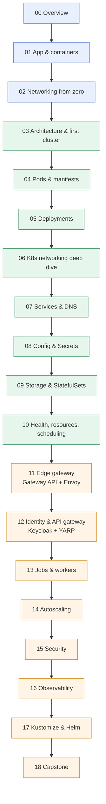

- 🔵 **Foundations (00–02):** the pieces under Kubernetes: containers, Linux networking, HTTP.
- 🟢 **Core Kubernetes (03–10):** the main objects and how they work.
- 🟠 **Production topics (11–18):** what makes a system real: two gateways, authentication,
  background jobs, scaling, security, observability, packaging.

### 3.10 Your tools, and where everything runs

You'll use five command-line tools. Here's what each one is and why it's needed.

| Tool        | What it is                                                                                                                  | Analogy                                   | Used from        |
| ----------- | --------------------------------------------------------------------------------------------------------------------------- | ----------------------------------------- | ---------------- |
| **Docker**  | Builds images and runs containers. Docker Desktop also provides the Linux VM the containers live in.                        | The factory and the shipping yard         | Step 01          |
| **kind**    | "**K**ubernetes **in** **D**ocker". Creates a real Kubernetes cluster where every **node** (machine) is a Docker container. | A model railway: real trains, small scale | Step 03          |
| **kubectl** | The command-line client for Kubernetes. Sends your manifests to the cluster and reads back state.                           | The phone you use to call the ops team    | Step 03          |
| **Helm**    | A package manager for Kubernetes. Installs complex software (Envoy Gateway, Prometheus) with one command.                   | `apt` / an app store, but for clusters    | Steps 11, 16, 17 |
| **git**     | Version control. Every step of this tutorial is a commit and a tag.                                                         | Save points in a video game               | All steps        |

**Where things physically run on your machine.** This matters for networking later:

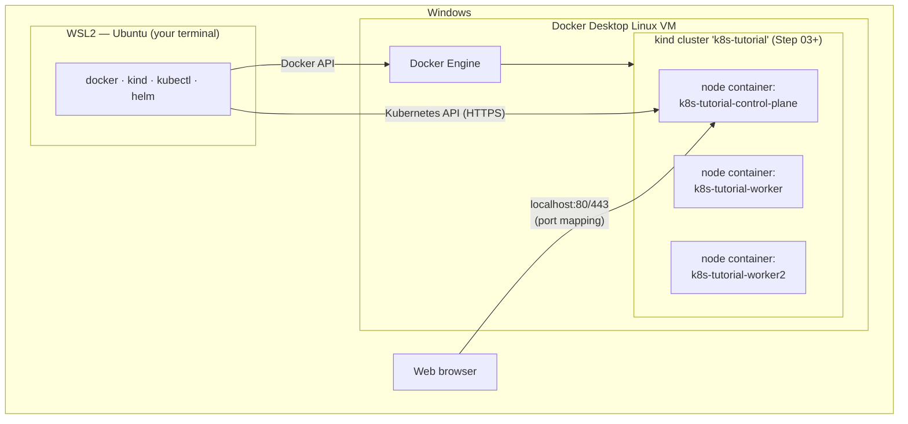

There are three layers of "machine" here:

1. **WSL2 (Ubuntu)**, where your terminal and tools live.
2. **Docker Desktop's VM**, a separate small Linux VM where containers actually run.
3. **kind node containers**. Each one _pretends to be a whole server_ and runs its own container
   runtime inside, so your app containers end up running **inside** containers. That's unusual,
   but it's what lets you have a 3-machine cluster on one laptop.

> ⚠️ **Quirk of your setup:** because containers live in Docker Desktop's VM, their internal IP
> addresses (for example `172.18.0.3`) are **not reachable from your WSL terminal or your
> browser**. To reach something inside, we use one of two methods:
>
> - **port mappings**: "forward my `localhost:80` to port X of that container" (set up in Step 03);
> - **`kubectl port-forward`**: a temporary tunnel through the Kubernetes API.
>
> On a native Linux machine you could reach those IPs directly. Here you can't, so the doc for each
> step will say which method to use.

> 💡 **Hostnames without editing any file:** names ending in `.localhost` (like
> `bookstore.localhost` and `auth.bookstore.localhost`) automatically point to your own machine
> (`127.0.0.1`) in modern browsers and in `curl`. That's why we can use real-looking hostnames
> without touching DNS or `/etc/hosts`.

> ⚠️ **You already have another cluster.** There's a kind cluster named `kube-shop` on your machine.
> Ours will be called **`k8s-tutorial`**, and we'll never touch the other one. With two clusters,
> one habit matters a lot: **always know which cluster `kubectl` is talking to** (its **context**).
> We'll practise this in the lab below.

### 3.11 How each step is organised

Every `docs/NN-*.md` file has the same sections, so you always know where to look:

| Section                       | What you'll find                                               |
| ----------------------------- | -------------------------------------------------------------- |
| Where we are                  | What exists so far and what this step adds                     |
| What you'll learn             | The goals                                                      |
| Concepts                      | The theory from zero, with diagrams                            |
| Hands-on lab                  | Commands to type, each one explained                           |
| Verify                        | How to prove it worked                                         |
| Break it on purpose           | Experiments that fail in useful ways, and how to diagnose them |
| Recap                         | The key ideas in a few lines                                   |
| Glossary                      | New words from this step                                       |
| Cleanup / state for next step | What to leave running                                          |
| Q&A                           | Your questions and the answers, added over time                |

**How to move forward:** read the doc, do the lab, ask anything that isn't clear, then say
**"go ahead"**. The guide (the AI agent) never skips ahead without your OK.

---

## 4. Hands-on lab

All commands in this step run in your **WSL terminal**, from the repository root:

```bash
cd ~/Github/kubernetes-tutorial
```

### 4.1 Check your machine

```bash
./scripts/check-prereqs.sh
```

- `./` means "the file in this folder", and the script needs to be executable (it already is).
- The script only **reads** information. It installs and changes nothing.

Output from your machine:

```text
1. Command-line tools
  ✔ docker found: Docker version 29.9.2, build a82e528
  ✔ kind found: kind v0.33.0 go1.26.7 linux/amd64
  ✔ kubectl found: Client Version: v1.37.2
  ✔ helm found: v4.3.1+gc0d08d0
  ✔ git found: git version 2.53.0
  ✔ curl found: curl 8.18.0 ...

2. Docker engine
  ✔ Docker daemon is running (Docker Desktop)
  ✔ Docker can use 15 GB RAM (need >= 6)
  ✔ Docker can use 8 CPUs (need >= 4)

3. Host ports we plan to use for the API gateway
  ✔ port 80 looks free
  ✔ port 443 looks free
  ! port 8080 is busy (expected: used by another cluster/app — we will NOT use it)

4. Existing kind clusters
  ! other kind cluster 'kube-shop' exists — the tutorial will leave it alone

Summary
  11 ok, 2 warnings, 0 failures
```

What each section means:

1. **Tools**: all five tools plus `curl` (a command-line HTTP client we'll use to call APIs).
2. **Docker engine**: Docker has to be _running_, not just installed. Note the **client/daemon**
   split: the `docker` command is a client that sends requests to a background service (the
   **daemon**), which does the actual work. Kubernetes uses exactly the same pattern: `kubectl` is
   a client, and the API server is the service.
3. **Ports**: later, your browser will reach the edge gateway through `localhost:80` (HTTP) and
   `localhost:443` (HTTPS). A port can only be used by one program at a time, so we check they're
   free.
4. **Existing clusters**: the two warnings are expected and harmless.

### 4.2 Your first container (a sanity check)

```bash
docker run --rm hello-world
```

- `docker run` means "create a container from an image and start it".
- `--rm` means "delete the container when it exits", so nothing is left lying around.
- `hello-world` is the image name. If it isn't on your machine, Docker downloads it from Docker
  Hub, a public **registry** (an online store of images).

The output describes exactly what happened:

```text
Hello from Docker!
...
 1. The Docker client contacted the Docker daemon.
 2. The Docker daemon pulled the "hello-world" image from the Docker Hub.
 3. The Docker daemon created a new container from that image which runs the
    executable that produces the output you are currently reading.
 4. The Docker daemon streamed that output to the Docker client, which sent it
    to your terminal.
```

Remember these four steps: **contact the daemon → pull the image → create the container → stream
the output**. Kubernetes does the same thing on every node, just automatically and at scale.

### 4.3 A container is a different "world"

Your WSL is Ubuntu. Let's run a container based on a _different_ Linux distribution (Alpine) and
look around inside it:

```bash
docker run --rm alpine:3.22 sh -c 'cat /etc/os-release | head -3; echo; hostname; echo; ps'
```

- `alpine:3.22` means image `alpine`, **tag** `3.22`. A tag is a version label. Always pin tags;
  never rely on "whatever is latest".
- `sh -c '…'` overrides the image's default command: run this little shell script instead.

Output:

```text
NAME="Alpine Linux"
ID=alpine
VERSION_ID=3.22.8

f1931ac8da35

PID   USER     TIME  COMMAND
    1 root      0:00 ps
```

Three surprises here, and Step 01 explains each one:

| You saw                                  | But your machine is…              | Why (Step 01)                                               |
| ---------------------------------------- | --------------------------------- | ----------------------------------------------------------- |
| `Alpine Linux`                           | Ubuntu 26.04                      | The container has its **own filesystem** (from the image).  |
| hostname `f1931ac8da35`                  | your WSL hostname                 | The container has its **own hostname** (UTS namespace).     |
| Only **one process**, and it's PID **1** | hundreds of processes are running | The container has its **own process list** (PID namespace). |

But it's still running on **the same Linux kernel** as everything else. A container isn't a
virtual machine. It's an ordinary process wearing blinkers.

### 4.4 Which cluster is kubectl talking to?

`kubectl` keeps a list of clusters it knows about in a file called the **kubeconfig**
(`~/.kube/config`). Each entry is a **context**, a combination of _which cluster_, _which
user/credentials_ and _which default namespace_.

```bash
kubectl config get-contexts
```

```text
CURRENT   NAME             CLUSTER          AUTHINFO         NAMESPACE
*         kind-kube-shop   kind-kube-shop   kind-kube-shop
```

- The `*` marks the **current** context: every `kubectl` command goes there unless you say
  otherwise.
- Right now that's the **other** project's cluster. When we create ours in Step 03, kind will add
  `kind-k8s-tutorial` and make it current.

You can always target a cluster explicitly, whatever the current context is:

```bash
kubectl --context kind-k8s-tutorial get nodes
```

```text
Error in configuration: context was not found for specified context: kind-k8s-tutorial
```

That error is **expected**: our cluster doesn't exist yet. You've just seen how kubectl fails when
it doesn't know a cluster. We'll create it in Step 03.

> 💡 Habit to build: before any command that changes things (`apply`, `delete`), glance at
> `kubectl config current-context`.

### 4.5 Explore the repository and its history

```bash
ls -la              # the files listed in "Where we are"
git log --oneline   # the commits so far
git tag -n          # the step tags with their descriptions
```

You'll see the Step 00 commits and one tag (`step-00`). From now on, after each step you can run:

```bash
git diff step-00 step-01 --stat   # which files a step added or changed
git show step-01                  # the full step commit
```

---

## 5. Verify

You're ready for Step 01 if:

- [ ] `./scripts/check-prereqs.sh` ends with **0 failures**.
- [ ] `docker run --rm hello-world` prints "Hello from Docker!".
- [ ] You can explain in one sentence the difference between an **image** and a **container**.
- [ ] You can explain in one sentence what **desired state** vs **actual state** means.
- [ ] You can explain the difference between the **edge gateway** (Envoy, configured with YAML) and
      the **API gateway** (YARP, our code), and say which one handles login.
- [ ] You can say why the APIs can trust `X-User-Id`, and what would break that trust.
- [ ] You know which command shows the cluster `kubectl` is currently talking to.

---

## 6. Break it on purpose

### 6.1 Stop Docker and see what fails

1. Quit Docker Desktop (tray icon → _Quit Docker Desktop_).
2. Run `docker ps`. You'll get something like:
   `Cannot connect to the Docker daemon at unix:///var/run/docker.sock. Is the docker daemon running?`
3. Run `./scripts/check-prereqs.sh`. Section 2 turns red.
4. Start Docker Desktop again, wait for it to be ready, and re-run the script.

**Lesson:** the `docker` CLI is only a client. With the daemon gone, the client has nobody to talk
to. You'll see the same pattern with Kubernetes: `kubectl` errors like `connection refused` almost
always mean "the API server isn't reachable", not "my YAML is wrong".

### 6.2 Ask for an image that doesn't exist

```bash
docker run --rm alpine:does-not-exist
```

```text
Unable to find image 'alpine:does-not-exist' locally
docker: Error response from daemon: failed to resolve reference "docker.io/library/alpine:does-not-exist": docker.io/library/alpine:does-not-exist: not found
```

**Lesson:** the daemon looked locally, then asked the registry (`docker.io` = Docker Hub;
`library/` is where official images live), and the registry has no such tag. In Kubernetes, this
same mistake shows up as a pod stuck in **`ErrImagePull` / `ImagePullBackOff`**. You'll meet it on
purpose in Step 04.

---

## 7. Recap

- Running software for real raises many problems: restarts, scaling, updates, configuration,
  discovery, and environment differences.
- **Containers** fix packaging and environment differences: an **image** is a package, and a
  **container** is a running, isolated instance of it, sharing the host's kernel.
- **Kubernetes** fixes operations. You **declare the desired state** in **manifests**, and
  **controllers** run a **reconciliation loop** that keeps reality equal to it.
- Kubernetes is built on ordinary Linux pieces (processes, namespaces, IP routing, NAT, DNS), and
  for many jobs it defines a **standard** that you fill with an **implementation**.
- An **API gateway** is a **reverse proxy** with API features. You can **configure** a finished one
  (Kubernetes **Gateway API** + **Envoy Gateway**, in YAML) or **write** your own (**YARP**, in C#).
  Neither is required on its own. We **stack** them: Envoy is the **edge** (HTTPS, hostnames, rate
  limits), and YARP is the **API gateway** (custom authentication, policies, identity headers).
- **Keycloak** manages users, passwords and tokens. Our gateway keeps tokens **server-side** (the
  BFF pattern), checks a **revoked list**, enforces **route policies**, and passes the user's
  identity to the APIs in **`X-User-*` headers**. NetworkPolicies make that trust safe.
- We'll build **Bookstore** on a 3-node **kind** cluster called `k8s-tutorial`.
- Your setup runs containers inside Docker Desktop's VM, so we reach them through **port mappings**
  or **port-forwarding**, not through their IPs.
- `kubectl` talks to whichever **context** is current, so always know which one that is.

---

## 8. Glossary

| Term                                  | Meaning                                                                                                                                      |
| ------------------------------------- | -------------------------------------------------------------------------------------------------------------------------------------------- |
| **Image**                             | A read-only package with an app and everything it needs to run (files, libraries, default command).                                          |
| **Container**                         | A running instance of an image: an isolated process on a shared Linux kernel.                                                                |
| **Registry**                          | A server that stores and distributes images (for example Docker Hub).                                                                        |
| **Tag**                               | A version label on an image (`alpine:3.22`).                                                                                                 |
| **Daemon**                            | A background service that does the actual work for a CLI client (Docker daemon, kubelet).                                                    |
| **Orchestrator**                      | A system that runs and manages containers across many machines (Kubernetes).                                                                 |
| **Cluster**                           | A set of machines (nodes) managed together by Kubernetes.                                                                                    |
| **Node**                              | One machine in a cluster. In kind, each node is a Docker container.                                                                          |
| **Object**                            | A record stored in Kubernetes that describes something you want (a Deployment, a Service, …).                                                |
| **Manifest**                          | A file (usually YAML) that describes one or more objects.                                                                                    |
| **Desired state**                     | What you declared you want.                                                                                                                  |
| **Actual state**                      | What is really running right now.                                                                                                            |
| **Controller**                        | A program that keeps comparing desired and actual state and acts to make them equal.                                                         |
| **Reconciliation loop**               | The never-ending compare → act → compare cycle a controller runs.                                                                            |
| **Declarative**                       | Describing _what_ result you want, rather than _how_ to get there (imperative).                                                              |
| **Reverse proxy**                     | A program in front of servers that receives client requests and forwards them to the right server.                                           |
| **Forward proxy**                     | A program in front of clients that makes requests to the Internet on their behalf.                                                           |
| **API gateway**                       | A reverse proxy specialised for APIs: routing, auth, rate limiting, header changes, …                                                        |
| **Edge gateway**                      | The gateway at the very edge of the cluster, where outside traffic enters. Ours is Envoy.                                                    |
| **Gateway API**                       | The Kubernetes standard (object types `GatewayClass`, `Gateway`, `HTTPRoute`, …) for describing how traffic enters a cluster.                |
| **Ingress**                           | The older, simpler Kubernetes standard for the same job as the Gateway API.                                                                  |
| **Envoy**                             | A high-performance reverse proxy program.                                                                                                    |
| **Envoy Gateway**                     | The controller that turns Gateway API objects into Envoy configuration.                                                                      |
| **YARP**                              | A .NET library for building your own reverse proxy / API gateway in code.                                                                    |
| **BFF**                               | Backend For Frontend: a gateway tailored to one frontend. Here it also keeps login tokens server-side.                                       |
| **TLS termination**                   | Decrypting HTTPS at a proxy, so services behind it receive plain HTTP.                                                                       |
| **Rate limiting**                     | Refusing requests beyond a set rate (e.g. 100 per second per client).                                                                        |
| **Authentication (AuthN)**            | Proving _who_ someone is. Failure → `401`.                                                                                                   |
| **Authorization (AuthZ)**             | Deciding what someone is _allowed_ to do. Failure → `403`.                                                                                   |
| **Identity provider (IdP)**           | A service that manages users and issues tokens proving their identity (Keycloak).                                                            |
| **Keycloak**                          | An open-source identity provider.                                                                                                            |
| **Realm / Client / Role**             | Keycloak's isolated user space / an app allowed to use Keycloak / a permission label.                                                        |
| **OAuth 2.0 / OpenID Connect (OIDC)** | Standard protocols for delegated login and for getting tokens about a user.                                                                  |
| **JWT**                               | JSON Web Token: a signed, readable token carrying claims (user, roles, expiry).                                                              |
| **JWKS**                              | The public keys an IdP publishes so anyone can verify its JWT signatures.                                                                    |
| **Session cookie**                    | A random id the browser sends with every request; the server looks up the real session data. `HttpOnly` cookies can't be read by JavaScript. |
| **XSS**                               | Cross-site scripting: malicious JavaScript running inside your page.                                                                         |
| **kubeconfig**                        | The file (`~/.kube/config`) where kubectl stores clusters, credentials and contexts.                                                         |
| **Context**                           | A named entry in the kubeconfig: cluster + user + default namespace.                                                                         |
| **kind**                              | Kubernetes IN Docker: a tool that creates local clusters whose nodes are containers.                                                         |
| **Helm**                              | A package manager for Kubernetes applications.                                                                                               |
| **Port mapping**                      | A rule that forwards a port on your machine to a port inside a container.                                                                    |

---

## 9. Cleanup / state for next step

Nothing to clean up. `hello-world` and `alpine` were started with `--rm`, so the containers are
already gone. The downloaded images stay cached, which is fine. To remove them anyway:

```bash
docker image rm hello-world alpine:3.22
```

**State at the end of Step 00:** the repository is initialised (tag `step-00`), your tools are
verified, and there's no cluster yet.

**Next — Step 01: the application and containers.** We'll write the code for every Bookstore
component (frontend, APIs, worker, the YARP API gateway with its custom auth logic, the Keycloak
realm configuration), package each one into an image with a Dockerfile, run the whole system with
Docker Compose, and take containers apart (namespaces, cgroups, image layers) to see there's no
magic inside.

---

## 10. Q&A

### Q1: Does Kubernetes have its own API gateway, or do we need an external one like YARP?

Kubernetes defines the **standard** for describing one (the **Gateway API**) but not the program
that does the work. You install an implementation such as **Envoy Gateway**. YARP is something
else: a library for **writing your own** gateway, which then runs as ordinary pods inside the
cluster. Truly external gateways (Azure API Management, AWS API Gateway) also exist. → Full
explanation in **§3.7.5–§3.7.7**.

### Q2: What's the difference between the YAML-configured gateway and the YARP-style one? Do we need both?

Both are **reverse proxies** doing API-gateway jobs. The difference is **where the logic lives**:
in **configuration** of a finished program (Envoy, via Gateway API YAML), or in **code** you write
(YARP). You **don't need both**: each works alone. We **stack** them because they have different
jobs and owners: Envoy at the edge for HTTPS, hostnames and rate limits, and YARP behind it for
custom authentication and business rules. → **§3.7.2–§3.7.4** (what they are) and
**§3.7.8–§3.7.10** (why both, how the work is split, and the trust chain).

### Q3: For authentication: Keycloak, a custom auth-api, or Keycloak + auth-api?

**Keycloak + custom logic inside the API gateway**, with no separate auth-api. Keycloak handles
users, passwords, login pages and tokens: the dangerous parts you should never build yourself. Our
gateway adds the custom parts: server-side sessions (BFF), a revoked-user list, route policies and
identity headers. A separate auth-api next to Keycloak would split identity across two places
without a clear job of its own. → **§3.8**, especially **§3.8.7**.
