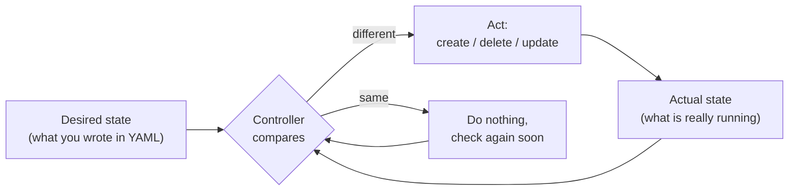
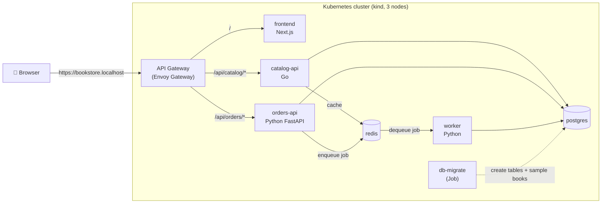
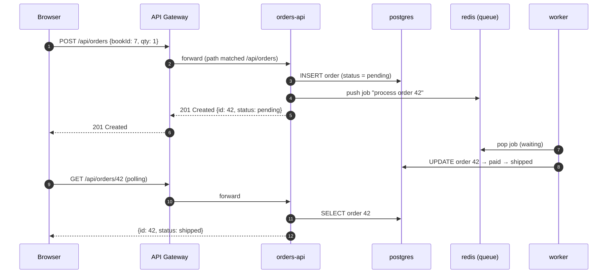
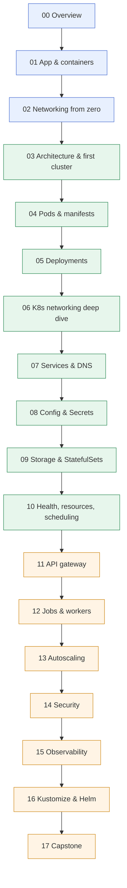
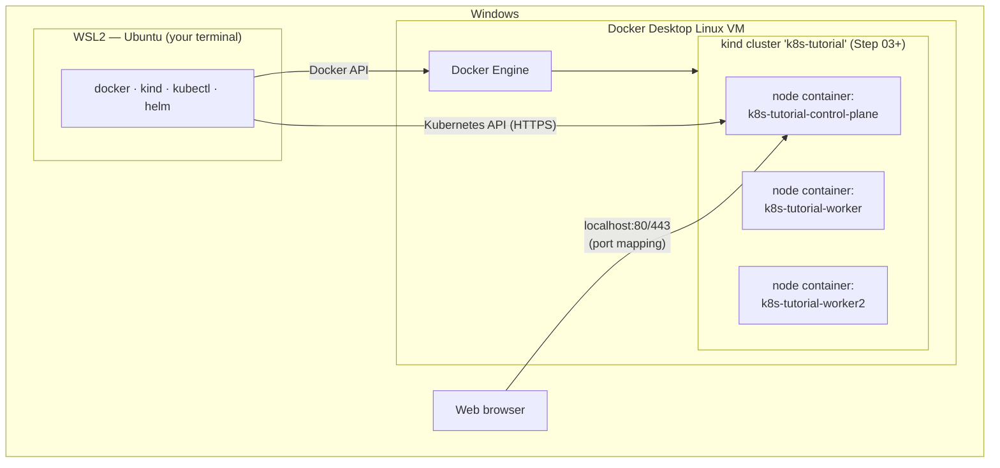
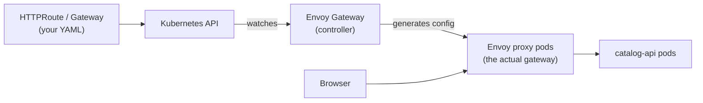
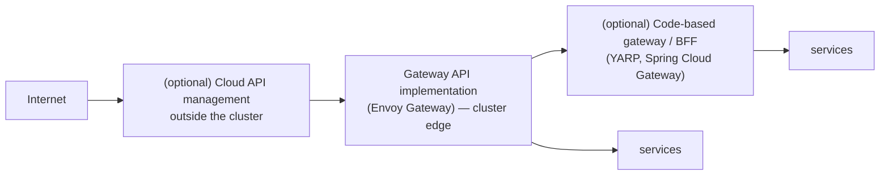

# Step 00 — Overview: what Kubernetes is, what we'll build, and your tools

> **Goal of this step:** understand *why* Kubernetes exists, see the complete system you will build
> by the end, get to know the tools on your machine, and confirm your machine is ready.
> No Kubernetes yet. We set up the starting point here.

---

## 1. Where we are

Nowhere yet, which is the right place to start. This repository has a few files that organise the
tutorial, plus one script that checks your machine:

```text
kubernetes-tutorial/
├── AGENTS.md            ← rules for the AI agent that guides you (CLAUDE.md points here)
├── CLAUDE.md -> AGENTS.md
├── TUTORIAL-INDEX.md    ← progress tracker: what's done, what's next
├── README.md
├── docs/
│   └── 00-overview.md   ← you are here
└── scripts/
    └── check-prereqs.sh ← checks that your machine is ready
```

Every step adds things to this tree. At the end it will contain five applications, a Kubernetes
cluster configuration, and about a hundred manifests.

---

## 2. What you'll learn

- What problem Kubernetes solves, explained without jargon.
- What a **container** is, in one paragraph (Step 01 goes into much more depth).
- What **Kubernetes** is: a system that keeps the **actual state** of your software equal to the
  **desired state** you describe.
- The full **Bookstore** system we'll build, and how a request travels through it.
- What each tool on your machine does: **Docker**, **kind**, **kubectl**, **Helm**, **git**.
- One quirk of your setup (WSL2 + Docker Desktop) that affects networking.
- How every step of this tutorial is organised.

---

## 3. Concepts

### 3.1 The problem: running software is harder than writing it

Say you wrote a small web application. On your laptop you start it with a single command, and it
listens for requests. Now other people need to use it. A list of questions shows up:

| Question | Without help, you… |
|---|---|
| **Where** does it run? | Rent a server, log in, install the right language version and libraries, copy the code. |
| It **crashed** at 3 a.m. Who restarts it? | You do, when you wake up. |
| The **server** died. | You set up a new server from scratch. |
| Lots of users arrived. How do you run **more copies**? | Buy more servers, install everything again, and put something in front to spread the traffic. |
| You have a **new version**. How do you update without downtime? | Stop, copy, start, and hope nothing breaks. |
| The app needs a **database password**. Where does it live? | In a file on the server, ideally not in the code. |
| You have 5 apps that **talk to each other**. How do they find each other? | You hard-code IP addresses, which break whenever something moves. |
| "**It works on my machine**" but not on the server. | Different library versions. Good luck. |

Every one of these problems is solvable by hand. But "by hand" doesn't scale: a company with
200 services on 50 machines can't have a person babysitting each one.

### 3.2 Step one of the solution: containers (preview)

A **container** packages an application **together with everything it needs to run**: the right
language runtime, libraries, config files, and even a minimal Linux userland. The package is called
an **image**. Run the image and you get a **container**, which is a normal process on the machine,
**isolated** from other processes. It sees its own filesystem, its own network, and its own process
list.

Analogy: a shipping container. A ship doesn't care whether a container holds bananas or laptops,
because all containers have the same shape. In the same way, a machine that can run containers can
run *any* containerised app, in any language, with no installation.

This fixes "it works on my machine": the machine is now *inside* the package.

> Step 01 opens the box: what an image really is (layers of files), and how Linux isolates a
> container (namespaces and cgroups). For now, hold on to **image = package** and
> **container = a running, isolated instance of that package**.

### 3.3 Step two of the solution: an orchestrator — Kubernetes

Containers solve **packaging**. They don't solve the rest of the table: restarts, many machines,
scaling, updates, configuration, and services finding each other. That's the job of an
**orchestrator**, and **Kubernetes** (often written **K8s**: K, then 8 letters, then s) is the
most widely used one.

**Analogy first.** Think of Kubernetes as a very diligent **operations team that never sleeps**.
You don't tell it *how* to do things step by step. You hand it a **written description of what you
want**:

> "I want 3 copies of the catalog API, version 1.4, each with 0.5 CPU and 256 MB of memory,
> reachable by other apps under the name `catalog-api`, and with the database password from the
> secret called `db-credentials`."

The team then works **continuously** to make reality match that description:

- A copy crashes → they start a new one.
- A machine dies → they move its copies to the machines that are still healthy.
- You change "3 copies" to "10" → they start 7 more.
- You change "version 1.4" to "1.5" → they replace the copies gradually, so the service never goes
  down.

**Now the precise version.** Kubernetes is a **declarative** system built on a **reconciliation
loop**:



1. You store the **desired state** in Kubernetes as small documents called **objects**, usually
   written as **YAML files** called **manifests**.
2. Many small programs called **controllers** each watch one kind of object. They compare desired
   state with actual state, and when the two differ, they act to close the gap.
3. They never stop. That's why Kubernetes **heals itself**: it isn't reacting to a single event, it
   keeps re-checking the gap.

That contrasts with the **imperative** style ("run this, then that"):

| Imperative ("how") | Declarative ("what") |
|---|---|
| `start container A` ×3 | `replicas: 3` |
| If one dies, someone has to notice and restart it | The controller sees 2 ≠ 3 and starts one more |
| A script describes *actions* | A manifest describes the *result* |

> 🔑 **Key idea of the whole tutorial:** in Kubernetes you **describe the result you want**, and
> controllers **continuously make it true**. Almost every feature you'll meet is a new kind of
> object plus a controller that makes it true.

### 3.4 What Kubernetes is *not*

Knowing what something doesn't do clears up a lot of confusion:

- **Not a container runtime.** It doesn't run containers itself. It asks a runtime (containerd) on
  each machine to do it.
- **Not a build tool.** It doesn't turn your code into images. You (or a CI pipeline) build the
  images first, then Kubernetes runs them.
- **Not one program.** It's a set of cooperating components (Step 03 takes them apart).
- **Not magic networking.** Every "it just reaches the other service" relies on ordinary Linux
  networking: IP addresses, routing tables, NAT rules, DNS. Steps 02, 06 and 07 show you each
  piece.
- **Not always necessary.** For one small app, a single server is fine. Kubernetes pays off when you
  have many services, many machines, or strict uptime needs. We'll learn it on a small system
  because the concepts are the same at any size.

### 3.5 The system you will build: **Bookstore**

A small online bookshop. It's small enough to understand completely, and realistic enough to need
every important Kubernetes feature.



| Component | What it does | Why it's in the tutorial |
|---|---|---|
| **API gateway** | The single front door. Looks at each request's path and forwards it to the right service. Also handles HTTPS, rate limiting, CORS and authentication. | Teaches how traffic gets **into** a cluster, and the Gateway API. |
| **frontend** | The website you see. Built with Next.js (a React framework). | A typical web app: stateless, easy to scale. |
| **catalog-api** | Returns the list of books and book details. Reads from Postgres and caches results in Redis. | Configuration, secrets, health checks, autoscaling. |
| **orders-api** | Accepts new orders, saves them, and puts a "process this order" job on a queue. | How services find and talk to each other, and network security rules. |
| **worker** | Takes jobs off the queue and "processes" orders (pending → paid → shipped). | Background work with no web traffic, and graceful shutdown. |
| **postgres** | The database: books and orders live here. | Data that must survive restarts: persistent storage and StatefulSets. |
| **redis** | An in-memory store used as a cache and as a job queue. | A stateful service whose data is safe to lose. |
| **db-migrate** | Runs once to create database tables and insert sample books. | Jobs: containers meant to finish rather than run forever. |
| **loadgen** | A small tool that floods the system with requests. | Lets us watch autoscaling happen. |

Why several languages? Kubernetes doesn't care what's inside a container. Go, Python and Node run
side by side, and that's the point.

### 3.6 The journey of one request (preview)

What happens when you click **"Buy"**:



That diagram looks simple, but each arrow hides several questions you'll learn to answer:

- How does `orders-api` know the IP address of `postgres`? → **DNS and Services** (Step 07)
- How does a packet get from a container on machine A to a container on machine B? → **pod
  networking and CNI** (Steps 02 and 06)
- What if there are 3 copies of `orders-api`: which one gets the request? → **Services and
  kube-proxy load balancing** (Step 07)
- Where does the database password come from? → **Secrets** (Step 08)
- What if postgres restarts: are the orders lost? → **PersistentVolumes** (Step 09)
- Who is allowed to talk to postgres? → **NetworkPolicies** (Step 14)

### 3.7 The learning map



- 🔵 **Foundations (00–02):** the pieces under Kubernetes: containers and Linux networking.
- 🟢 **Core Kubernetes (03–10):** the main objects and how they work.
- 🟠 **Production topics (11–17):** what makes a system real: a gateway, background jobs, scaling,
  security, observability, packaging.

### 3.8 Your tools, and where everything runs

You'll use five command-line tools. Here's what each one is and why it's needed.

| Tool | What it is | Analogy | Used from |
|---|---|---|---|
| **Docker** | Builds images and runs containers. Docker Desktop also provides the Linux VM the containers live in. | The factory and the shipping yard | Step 01 |
| **kind** | "**K**ubernetes **in** **D**ocker". Creates a real Kubernetes cluster where every **node** (machine) is a Docker container. | A model railway: real trains, small scale | Step 03 |
| **kubectl** | The command-line client for Kubernetes. Sends your manifests to the cluster and reads back state. | The phone you use to call the ops team | Step 03 |
| **Helm** | A package manager for Kubernetes. Installs complex software (Envoy Gateway, Prometheus) with one command. | `apt` / an app store, but for clusters | Steps 11, 15, 16 |
| **git** | Version control. Every step of this tutorial is a commit and a tag. | Save points in a video game | All steps |

**Where things physically run on your machine.** This matters for networking later:



There are three layers of "machine" here:

1. **WSL2 (Ubuntu)**, where your terminal and tools live.
2. **Docker Desktop's VM**, a separate small Linux VM where containers actually run.
3. **kind node containers**. Each one *pretends to be a whole server* and runs its own container
   runtime inside, so your app containers end up running **inside** containers. That's unusual,
   but it's what lets you have a 3-machine cluster on one laptop.

> ⚠️ **Quirk of your setup:** because containers live in Docker Desktop's VM, their internal IP
> addresses (for example `172.18.0.3`) are **not reachable from your WSL terminal or your
> browser**. To reach something inside, we use one of two methods:
> - **port mappings**: "forward my `localhost:80` to port X of that container" (set up in Step 03);
> - **`kubectl port-forward`**: a temporary tunnel through the Kubernetes API.
>
> On a native Linux machine you could reach those IPs directly. Here you can't, so the doc for each
> step will say which method to use.

> ⚠️ **You already have another cluster.** There's a kind cluster named `kube-shop` on your machine.
> Ours will be called **`k8s-tutorial`**, and we'll never touch the other one. With two clusters,
> one habit matters a lot: **always know which cluster `kubectl` is talking to** (its **context**).
> We'll practise this in the lab below.

### 3.9 How each step is organised

Every `docs/NN-*.md` file has the same sections, so you always know where to look:

| Section | What you'll find |
|---|---|
| Where we are | What exists so far and what this step adds |
| What you'll learn | The goals |
| Concepts | The theory from zero, with diagrams |
| Hands-on lab | Commands to type, each one explained |
| Verify | How to prove it worked |
| Break it on purpose | Experiments that fail in useful ways, and how to diagnose them |
| Recap | The key ideas in a few lines |
| Glossary | New words from this step |
| Cleanup / state for next step | What to leave running |
| Q&A | Your questions and the answers, added over time |

**How to move forward:** read the doc, do the lab, ask anything that isn't clear, then say
**"go ahead"**. The guide (the AI agent) never skips ahead without your OK.

---

## 4. Hands-on lab

All commands in this step run in your **WSL terminal**, from the repository root:

```bash
cd ~/Github/kubernetes-tutorial
```

### 4.1 Check your machine

```bash
./scripts/check-prereqs.sh
```

- `./` means "the file in this folder", and the script needs to be executable (it already is).
- The script only **reads** information. It installs and changes nothing.

Output from your machine:

```text
1. Command-line tools
  ✔ docker found: Docker version 29.9.2, build a82e528
  ✔ kind found: kind v0.33.0 go1.26.7 linux/amd64
  ✔ kubectl found: Client Version: v1.37.2
  ✔ helm found: v4.3.1+gc0d08d0
  ✔ git found: git version 2.53.0
  ✔ curl found: curl 8.18.0 ...

2. Docker engine
  ✔ Docker daemon is running (Docker Desktop)
  ✔ Docker can use 15 GB RAM (need >= 6)
  ✔ Docker can use 8 CPUs (need >= 4)

3. Host ports we plan to use for the API gateway
  ✔ port 80 looks free
  ✔ port 443 looks free
  ! port 8080 is busy (expected: used by another cluster/app — we will NOT use it)

4. Existing kind clusters
  ! other kind cluster 'kube-shop' exists — the tutorial will leave it alone

Summary
  11 ok, 2 warnings, 0 failures
```

What each section means:

1. **Tools**: all five tools plus `curl` (a command-line HTTP client we'll use to call APIs).
2. **Docker engine**: Docker has to be *running*, not just installed. Note the **client/daemon**
   split: the `docker` command is a client that sends requests to a background service (the
   **daemon**), which does the actual work. Kubernetes uses exactly the same pattern: `kubectl` is
   a client, and the API server is the service.
3. **Ports**: later, your browser will reach the cluster through `localhost:80` (HTTP) and
   `localhost:443` (HTTPS). A port can only be used by one program at a time, so we check they're
   free.
4. **Existing clusters**: the two warnings are expected and harmless.

### 4.2 Your first container (a sanity check)

```bash
docker run --rm hello-world
```

- `docker run` means "create a container from an image and start it".
- `--rm` means "delete the container when it exits", so nothing is left lying around.
- `hello-world` is the image name. If it isn't on your machine, Docker downloads it from Docker
  Hub, a public **registry** (an online store of images).

The output describes exactly what happened:

```text
Hello from Docker!
...
 1. The Docker client contacted the Docker daemon.
 2. The Docker daemon pulled the "hello-world" image from the Docker Hub.
 3. The Docker daemon created a new container from that image which runs the
    executable that produces the output you are currently reading.
 4. The Docker daemon streamed that output to the Docker client, which sent it
    to your terminal.
```

Remember these four steps: **contact the daemon → pull the image → create the container → stream
the output**. Kubernetes does the same thing on every node, just automatically and at scale.

### 4.3 A container is a different "world"

Your WSL is Ubuntu. Let's run a container based on a *different* Linux distribution (Alpine) and
look around inside it:

```bash
docker run --rm alpine:3.22 sh -c 'cat /etc/os-release | head -3; echo; hostname; echo; ps'
```

- `alpine:3.22` means image `alpine`, **tag** `3.22`. A tag is a version label. Always pin tags;
  never rely on "whatever is latest".
- `sh -c '…'` overrides the image's default command: run this little shell script instead.

Output:

```text
NAME="Alpine Linux"
ID=alpine
VERSION_ID=3.22.8

f1931ac8da35

PID   USER     TIME  COMMAND
    1 root      0:00 ps
```

Three surprises here, and Step 01 explains each one:

| You saw | But your machine is… | Why (Step 01) |
|---|---|---|
| `Alpine Linux` | Ubuntu 26.04 | The container has its **own filesystem** (from the image). |
| hostname `f1931ac8da35` | your WSL hostname | The container has its **own hostname** (UTS namespace). |
| Only **one process**, and it's PID **1** | hundreds of processes are running | The container has its **own process list** (PID namespace). |

But it's still running on **the same Linux kernel** as everything else. A container isn't a
virtual machine. It's an ordinary process wearing blinkers.

### 4.4 Which cluster is kubectl talking to?

`kubectl` keeps a list of clusters it knows about in a file called the **kubeconfig**
(`~/.kube/config`). Each entry is a **context**, a combination of *which cluster*, *which
user/credentials* and *which default namespace*.

```bash
kubectl config get-contexts
```

```text
CURRENT   NAME             CLUSTER          AUTHINFO         NAMESPACE
*         kind-kube-shop   kind-kube-shop   kind-kube-shop
```

- The `*` marks the **current** context: every `kubectl` command goes there unless you say
  otherwise.
- Right now that's the **other** project's cluster. When we create ours in Step 03, kind will add
  `kind-k8s-tutorial` and make it current.

You can always target a cluster explicitly, whatever the current context is:

```bash
kubectl --context kind-k8s-tutorial get nodes
```

```text
Error in configuration: context was not found for specified context: kind-k8s-tutorial
```

That error is **expected**: our cluster doesn't exist yet. You've just seen how kubectl fails when
it doesn't know a cluster. We'll create it in Step 03.

> 💡 Habit to build: before any command that changes things (`apply`, `delete`), glance at
> `kubectl config current-context`.

### 4.5 Explore the repository and its history

```bash
ls -la              # the files listed in "Where we are"
git log --oneline   # one line per commit — one commit per step
git tag -n          # the step tags with their descriptions
```

You should see one commit (`step 00: ...`) and one tag (`step-00`). From now on, after each step
you can run:

```bash
git diff step-00 step-01 --stat   # which files a step added or changed
git show step-01                  # the full step commit
```

---

## 5. Verify

You're ready for Step 01 if:

- [ ] `./scripts/check-prereqs.sh` ends with **0 failures**.
- [ ] `docker run --rm hello-world` prints "Hello from Docker!".
- [ ] You can explain in one sentence the difference between an **image** and a **container**.
- [ ] You can explain in one sentence what **desired state** vs **actual state** means.
- [ ] You know which command shows the cluster `kubectl` is currently talking to.

---

## 6. Break it on purpose

### 6.1 Stop Docker and see what fails

1. Quit Docker Desktop (tray icon → *Quit Docker Desktop*).
2. Run `docker ps`. You'll get something like:
   `Cannot connect to the Docker daemon at unix:///var/run/docker.sock. Is the docker daemon running?`
3. Run `./scripts/check-prereqs.sh`. Section 2 turns red.
4. Start Docker Desktop again, wait for it to be ready, and re-run the script.

**Lesson:** the `docker` CLI is only a client. With the daemon gone, the client has nobody to talk
to. You'll see the same pattern with Kubernetes: `kubectl` errors like `connection refused` almost
always mean "the API server isn't reachable", not "my YAML is wrong".

### 6.2 Ask for an image that doesn't exist

```bash
docker run --rm alpine:does-not-exist
```

```text
Unable to find image 'alpine:does-not-exist' locally
docker: Error response from daemon: failed to resolve reference "docker.io/library/alpine:does-not-exist": docker.io/library/alpine:does-not-exist: not found
```

**Lesson:** the daemon looked locally, then asked the registry (`docker.io` = Docker Hub; `library/` is where official images live), and the registry has no such tag.
In Kubernetes, this same mistake shows up as a pod stuck in **`ErrImagePull` / `ImagePullBackOff`**.
You'll meet it on purpose in Step 04.

---

## 7. Recap

- Running software for real raises many problems: restarts, scaling, updates, configuration,
  discovery, and environment differences.
- **Containers** fix packaging and environment differences: an **image** is a package, and a
  **container** is a running, isolated instance of it, sharing the host's kernel.
- **Kubernetes** fixes operations. You **declare the desired state** in **manifests**, and
  **controllers** run a **reconciliation loop** that keeps reality equal to it.
- Kubernetes is built on ordinary Linux pieces (processes, namespaces, IP routing, NAT, DNS), and
  this tutorial will show you each of them.
- We'll build **Bookstore**: a Next.js frontend, Go and Python APIs, a worker, Postgres, Redis and an
  API gateway, on a 3-node **kind** cluster called `k8s-tutorial`.
- Your setup runs containers inside Docker Desktop's VM, so we reach them through **port mappings**
  or **port-forwarding**, not through their IPs.
- `kubectl` talks to whichever **context** is current, so always know which one that is.

---

## 8. Glossary

| Term | Meaning |
|---|---|
| **Image** | A read-only package with an app and everything it needs to run (files, libraries, default command). |
| **Container** | A running instance of an image: an isolated process on a shared Linux kernel. |
| **Registry** | A server that stores and distributes images (for example Docker Hub). |
| **Tag** | A version label on an image (`alpine:3.22`). |
| **Daemon** | A background service that does the actual work for a CLI client (Docker daemon, kubelet). |
| **Orchestrator** | A system that runs and manages containers across many machines (Kubernetes). |
| **Cluster** | A set of machines (nodes) managed together by Kubernetes. |
| **Node** | One machine in a cluster. In kind, each node is a Docker container. |
| **Object** | A record stored in Kubernetes that describes something you want (a Deployment, a Service, …). |
| **Manifest** | A file (usually YAML) that describes one or more objects. |
| **Desired state** | What you declared you want. |
| **Actual state** | What is really running right now. |
| **Controller** | A program that keeps comparing desired and actual state and acts to make them equal. |
| **Reconciliation loop** | The never-ending compare → act → compare cycle a controller runs. |
| **Declarative** | Describing *what* result you want, rather than *how* to get there (imperative). |
| **kubeconfig** | The file (`~/.kube/config`) where kubectl stores clusters, credentials and contexts. |
| **Context** | A named entry in the kubeconfig: cluster + user + default namespace. |
| **kind** | Kubernetes IN Docker: a tool that creates local clusters whose nodes are containers. |
| **Helm** | A package manager for Kubernetes applications. |
| **Port mapping** | A rule that forwards a port on your machine to a port inside a container. |

---

## 9. Cleanup / state for next step

Nothing to clean up. `hello-world` and `alpine` were started with `--rm`, so the containers are
already gone. The downloaded images stay cached, which is fine. To remove them anyway:

```bash
docker image rm hello-world alpine:3.22
```

**State at the end of Step 00:** the repository is initialised (tag `step-00`), your tools are
verified, and there's no cluster yet.

**Next — Step 01: the application and containers.** We'll write the code for every Bookstore
component, package each one into an image with a Dockerfile, run the whole system with Docker
Compose, and take containers apart (namespaces, cgroups, image layers) to see there's no magic
inside.

---

## 10. Q&A

### Q: Does Kubernetes have its own API gateway, or do we need an external one (like YARP in C#)?

**Short answer:** Kubernetes provides the **standard for describing** an API gateway (the
**Gateway API**), but **not the program that does the work**. You install one of many
implementations. YARP is a different kind of thing: a library for **writing your own** gateway as a
normal application.

**1. Kubernetes defines interfaces, and other projects implement them.** This pattern comes up again
and again:

| Kubernetes defines… | …and you pick an implementation |
|---|---|
| How containers are run (CRI) | containerd, CRI-O |
| How pods get a network (CNI) | kindnet, Calico, Cilium (Step 06) |
| How storage is attached (CSI) | local-path, AWS EBS, Azure Disk (Step 09) |
| **How traffic enters the cluster (Gateway API)** | **Envoy Gateway, NGINX Gateway Fabric, Istio, Cilium, Kong, Traefik, …** |

The Gateway API is a set of object types (`GatewayClass`, `Gateway`, `HTTPRoute`, `GRPCRoute`, …).
You write them in YAML like everything else:

```yaml
# "Requests whose path starts with /api/catalog go to the catalog-api Service"
apiVersion: gateway.networking.k8s.io/v1
kind: HTTPRoute
metadata:
  name: catalog
spec:
  parentRefs: [{ name: bookstore-gateway }]
  rules:
    - matches: [{ path: { type: PathPrefix, value: /api/catalog } }]
      backendRefs: [{ name: catalog-api, port: 80 }]
```

On its own, Kubernetes **stores** this object and does nothing else with it. Something has to read
it and do the work. That's a **controller**, the same pattern as in §3.3. With **Envoy Gateway**
(our choice):



- **Envoy** is a high-performance proxy (written in C++), widely used in production.
- **Envoy Gateway** is the controller that turns your Gateway API objects into Envoy configuration.
- Swapping in NGINX Gateway Fabric or Istio needs **no changes to your HTTPRoutes**. That
  portability is the whole point of having a standard.

The older, simpler version of this standard is called **Ingress**. You'll still find it everywhere,
and we'll compare the two in Step 11.

**2. YARP is a "build your own gateway" library.** YARP (Yet Another Reverse Proxy) is a .NET
library. You write a C# application, configure routes in code or in `appsettings.json`, build an
image, and deploy it **like any other app** (a Deployment plus a Service). Spring Cloud Gateway
(Java) and Ocelot (.NET) are similar.

Two things to note:

- It doesn't run "outside" Kubernetes. It's **one more pod inside the cluster**.
- It still has to **receive traffic from outside**, so it usually sits *behind* a Gateway API /
  Ingress implementation or a `LoadBalancer` Service.

**3. Truly external gateways also exist.** Cloud services such as Azure API Management, AWS API
Gateway or Kong Konnect run **outside** the cluster, in front of the cluster's load balancer.
Companies use them for API products: developer portals, API keys, billing, analytics.

**How the three are combined in practice:**



| | Gateway API + Envoy Gateway | YARP (code-based) | Cloud API management |
|---|---|---|---|
| Where it runs | In the cluster (controller + proxy pods) | In the cluster (your app's pods) | Outside, run by the cloud provider |
| How you configure it | Kubernetes YAML (`HTTPRoute`, policies) | C# code / JSON | Cloud portal / IaC |
| Strengths | Kubernetes-native, standard, portable, each team owns its routes | Unlimited custom logic: aggregation, custom auth, request transforms | Developer portal, API keys, monetisation |
| Weaknesses | Custom logic is limited to what the implementation supports | You write and maintain the code, and still need an entry point in front | Cost, vendor lock-in, extra network hop |
| Typical use | Default entry point of a cluster | Backend-for-frontend (BFF) or special logic | Public APIs sold or shared with partners |

**Why this tutorial uses Envoy Gateway:** it's the Kubernetes-native way and the part every
cluster needs. It also covers our needs (routing, TLS, rate limiting, CORS, JWT) without custom
code. A YARP layer could be added behind it as an optional exercise.
